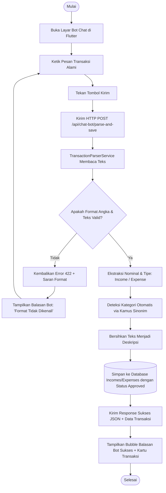
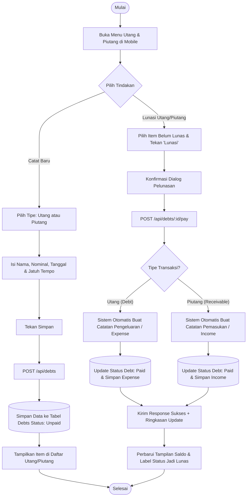
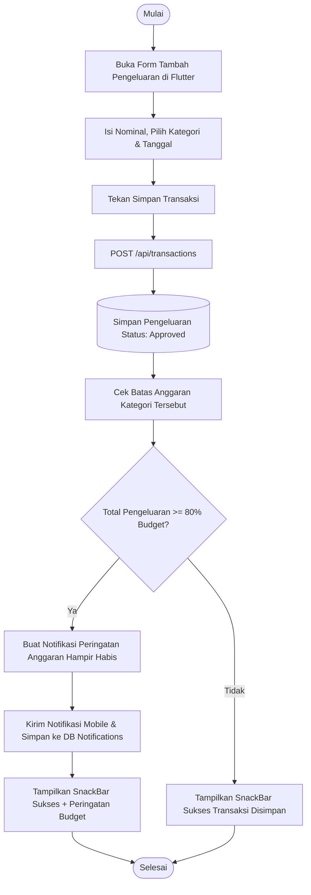
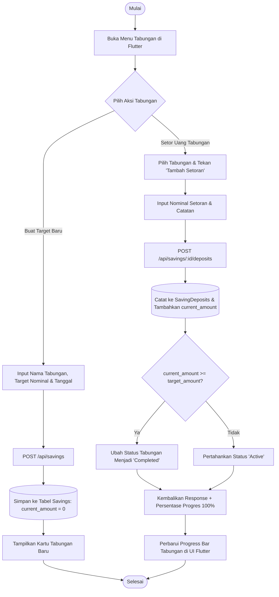
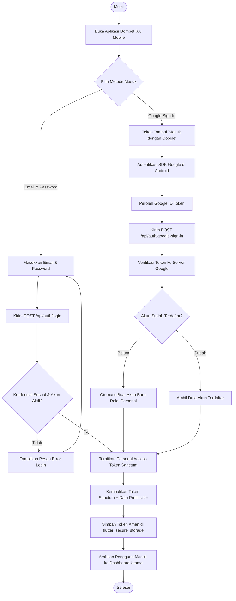

# Dokumentasi Activity Diagram DompetKuu v2.1
**Sistem**: DompetKuu (Mobile Flutter Personal + Web Admin Filament)  
**Versi**: 2.1 (Oktober 2026)

Activity diagram berikut menggambarkan alur kerja langkah demi langkah, percabangan keputusan (*decision*), serta pembagian peran (*swimlane*) antara **Pengguna (Mobile Flutter)**, **Backend API (Laravel)**, dan **Database**.

---

## 1. Activity Diagram: Catat Transaksi Cepat via Bot Chat (Quick Entry Bot)
Menggambarkan alur pengguna saat mengetik transaksi menggunakan bahasa sehari-hari (contoh: *"Makan 10.000 Makan Siang"*).

---

## 2. Activity Diagram: Pengelolaan & Pelunasan Utang/Piutang
Menggambarkan alur pencatatan utang/piutang serta fitur pelunasan sekali klik (*mark as paid*) yang otomatis memicu pencatatan arus kas.

---

## 3. Activity Diagram: Transaksi Manual & Peringatan Anggaran (Budget Alert)
Menggambarkan pencatatan pengeluaran biasa disertai pengecekan batas anggaran (*budget limit*).

---

## 4. Activity Diagram: Pengelolaan Tabungan & Setoran Deposit
Menggambarkan alur menabung dengan target dan penambahan setoran secara bertahap.

---

## 5. Activity Diagram: Autentikasi Pengguna Mobile (Email & Google Sign-In)
Menggambarkan alur login pengguna mobile hingga memperoleh token otentikasi Sanctum.

