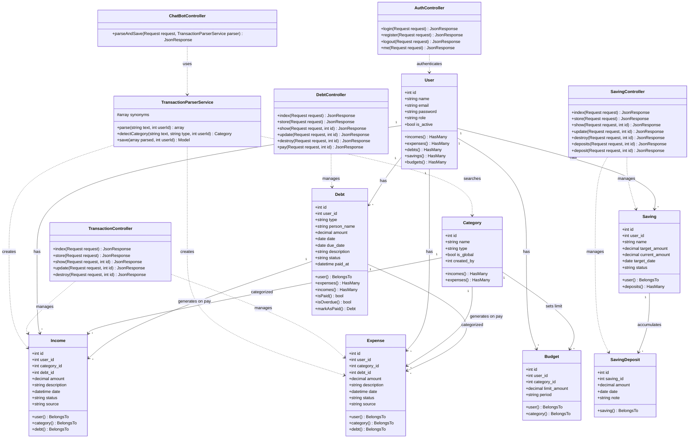
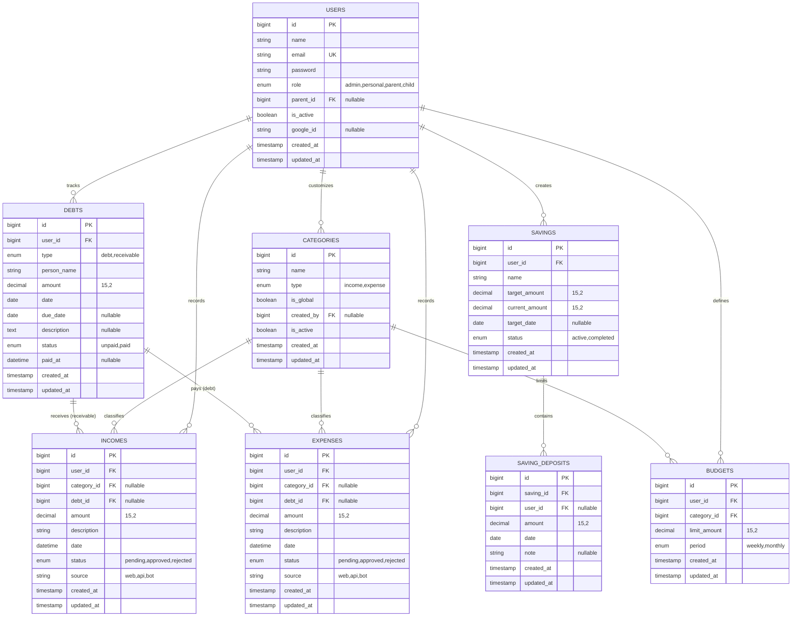

# Dokumentasi Class Diagram & ERD DompetKuu v2.1
**Sistem**: DompetKuu (Mobile Flutter Personal + Laravel REST API)  
**Versi**: 2.1 (Oktober 2026)

Dokumen ini memuat arsitektur struktur kode perangkat lunak (**Class Diagram**) dan rancangan struktur basis data relasional (**Entity Relationship Diagram / ERD**).

---

## 1. Class Diagram (Struktur Kelas Backend & Mobile)

Diagram kelas berikut menampilkan Controller API, Service Layer, dan Eloquent Model beserta atribut (*attributes*) dan fungsi (*methods*), serta relasi asosiasi dan dependensinya.

---

## 2. Entity Relationship Diagram (ERD)

Diagram ERD berikut memodelkan skema basis data relasional MariaDB/MySQL yang digunakan oleh DompetKuu v2.1.

---

## 3. Penjelasan Desain Arsitektur & Relasi

1. **Relasi Arus Kas Otomatis Utang (`debt_id` di `incomes` & `expenses`):**
   - Kolom `debt_id` pada tabel `incomes` dan `expenses` berperan sebagai foreign key opsional (*nullable*). Saat utang dilunasi, baris transaksi yang tercipta langsung tertaut ke ID utang terkait, memudahkan pelacakan asal-usul pengeluaran/pemasukan.
2. **Kategori Global vs Personal:**
   - Kategori dengan `is_global = true` dapat digunakan oleh seluruh pengguna aplikasi mobile. Pengguna juga dapat membuat kategori khusus pribadi (`created_by = user_id`).
3. **Penyederhanaan Role Mobile (Personal):**
   - Transaksi yang dimasukkan dari aplikasi mobile Flutter otomatis memiliki `status = 'approved'` dan `source = 'api'` atau `'bot'`, sehingga langsung masuk ke kalkulasi saldo tanpa memerlukan alur persetujuan.
