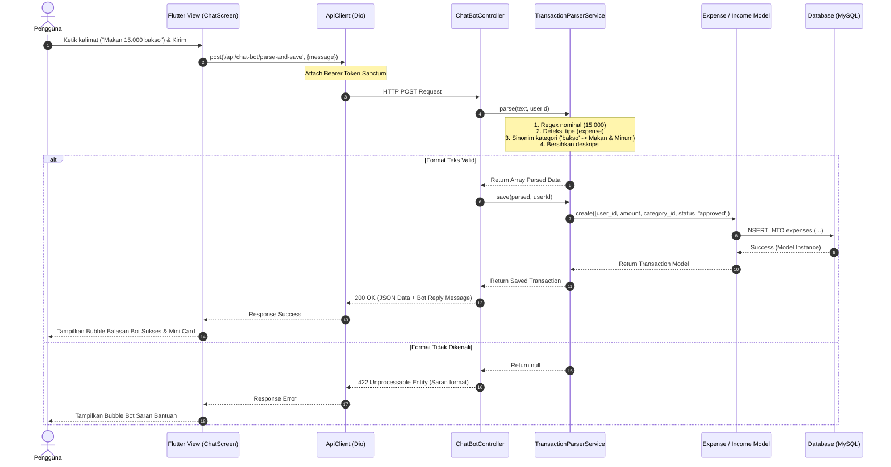
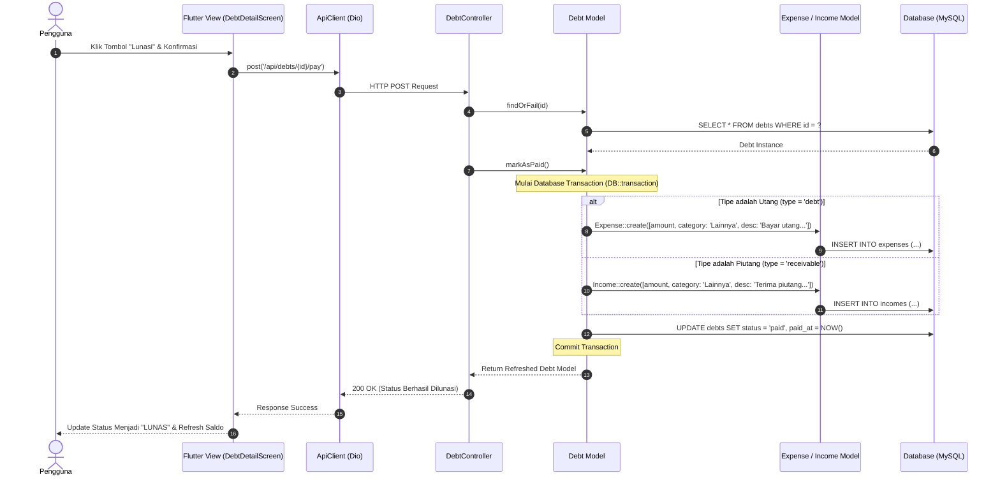
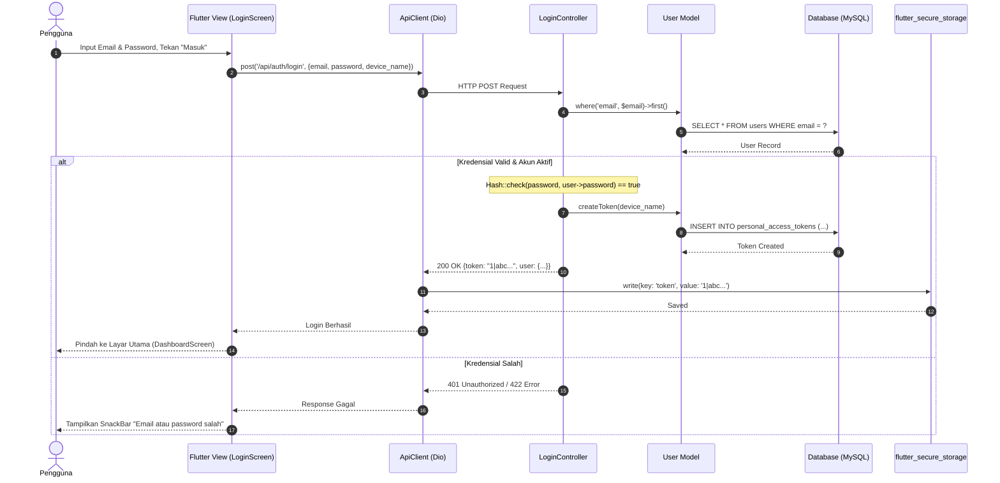
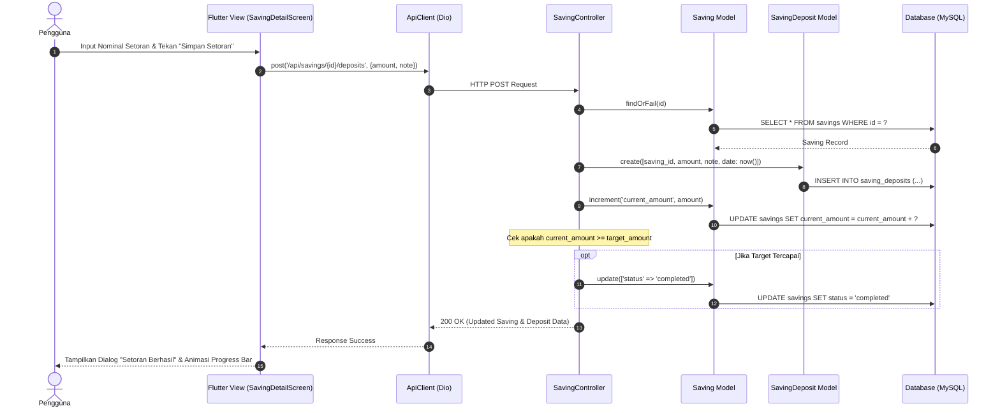

# Dokumentasi Sequence Diagram DompetKuu v2.1
**Sistem**: DompetKuu (Mobile Flutter Personal + Laravel REST API)  
**Versi**: 2.1 (Oktober 2026)

Sequence Diagram berikut menggambarkan interaksi objek secara kronologis antar layer:
`Flutter UI` $\rightarrow$ `HTTP Client (Dio)` $\rightarrow$ `Laravel API Controller` $\rightarrow$ `Service / Eloquent Model` $\rightarrow$ `Database (MySQL)`.

---

## 1. Sequence Diagram: Catat Cepat via Bot Chat
Menggambarkan interaksi saat pengguna mengirim kalimat transaksi alami (misal: *"Makan 15.000 bakso"*) hingga transaksi tersimpan dan bot membalas.

---

## 2. Sequence Diagram: Pelunasan Utang / Piutang Otomatis
Menggambarkan interaksi ketika pengguna menekan tombol "Lunasi" pada data utang/piutang, memicu transaksi pelunasan dan otomatisasi arus kas.

---

## 3. Sequence Diagram: Autentikasi Login Pengguna Mobile
Menggambarkan proses pertukaran kredensial login dengan token otentikasi Sanctum serta penyimpanan lokal di Android.

---

## 4. Sequence Diagram: Setor Tabungan (Savings Deposit)
Menggambarkan interaksi saat pengguna menambahkan setoran ke target tabungan hingga perhitungan progres target.

