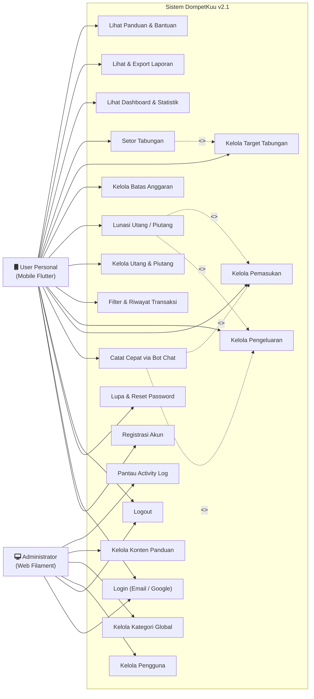

# Dokumentasi Use Case Diagram DompetKuu v2.1
**Sistem**: DompetKuu (Mobile Flutter Personal + Web Admin Filament)  
**Versi**: 2.1 (Oktober 2026)

---

## 1. Diagram Use Case Visual (Mermaid)

---

## 2. Definisi Aktor

| Aktor | Deskripsi Peran & Akses Platform |
|---|---|
| **User Personal** | Pengguna akhir aplikasi yang mengelola keuangan pribadi melalui **Aplikasi Mobile Flutter**. Berhak mencatat pemasukan, pengeluaran, bot chat cepat, utang/piutang, tabungan, anggaran, serta melihat laporan keuangan. |
| **Administrator** | Pengelola sistem dengan hak akses penuh melalui **Panel Web Filament**. Bertanggung jawab memonitor data master pengguna, mengelola kategori global, konten panduan, dan audit aktivitas pengguna (*activity log*). |

---

## 3. Skenario Use Case Utama (Use Case Descriptions)

### UC-01: Catat Transaksi Cepat via Bot Chat (Fitur Baru)
* **Aktor Utama**: User Personal (Mobile)
* **Deskripsi**: Pengguna mencatat transaksi keuangan secara instan menggunakan pesan teks dengan bahasa alami tanpa harus mengisi formulir manual.
* **Pre-condition**: Pengguna sudah login di aplikasi mobile Flutter.
* **Post-condition**: Transaksi berhasil disimpan di database dengan status `approved`, dan saldo terbarui.
* **Alur Utama (Normal Flow)**:
  1. Pengguna membuka menu / layar Bot Chat di aplikasi mobile.
  2. Pengguna mengetik kalimat transaksi (misal: *"Makan 10.000 Makan Siang"* atau *"Gaji 3.000.000 kantor"*), lalu menekan tombol kirim.
  3. Aplikasi mobile mengirim payload pesan ke API endpoint `POST /api/chat-bot/parse-and-save`.
  4. Backend menjalankan `TransactionParserService` untuk mengekstrak nominal angka, menentukan tipe (income/expense), mendeteksi kategori via sinonim, dan membersihkan deskripsi.
  5. Backend menyimpan data transaksi ke database dengan status `approved`.
  6. Backend mengirimkan respon konfirmasi data transaksi yang tersimpan.
  7. Aplikasi mobile menampilkan balasan bot berupa bubble teks dan kartu ringkasan transaksi sukses.
* **Alur Alternatif (Alternative Flow)**:
  - *4a. Format teks tidak dikenali*: Jika sistem tidak menemukan nominal angka atau format tidak sesuai, backend mengembalikan status 422 dengan pesan bantuan format contoh. Aplikasi menampilkan bubble saran dari bot.

---

### UC-02: Kelola & Lunasi Utang/Piutang (Fitur Baru)
* **Aktor Utama**: User Personal (Mobile)
* **Deskripsi**: Pengguna mencatat pinjaman (utang/piutang), memantau jatuh tempo, dan melakukan pelunasan otomatis.
* **Pre-condition**: Pengguna sudah login di aplikasi mobile.
* **Post-condition**: Catatan utang/piutang bertambah, dan saat dilunasi akan otomatis membuat transaksi kas baru.
* **Alur Utama (Pencatatan)**:
  1. Pengguna membuka menu Utang & Piutang.
  2. Pengguna memilih tipe (Utang atau Piutang), mengisi nama orang, nominal, tanggal, tanggal jatuh tempo, dan keterangan.
  3. Sistem menyimpan data utang/piutang dengan status `unpaid`.
* **Alur Utama (Pelunasan Otomatis)**:
  1. Pengguna menekan tombol "Lunasi" pada salah satu item yang berstatus `unpaid`.
  2. Sistem meminta konfirmasi pelunasan.
  3. Pengguna mengonfirmasi, aplikasi memanggil API `POST /api/debts/{id}/pay`.
  4. Backend mengubah status utang menjadi `paid`.
  5. **Aturan Otomatis Arus Kas**:
     - Jika tipe adalah **Utang** (*debt*), backend otomatis membuat catatan **Pengeluaran** (*Expense*).
     - Jika tipe adalah **Piutang** (*receivable*), backend otomatis membuat catatan **Pemasukan** (*Income*).
  6. Sistem memperbarui ringkasan total utang/piutang dan saldo akun.

---

### UC-03: Kelola Anggaran & Peringatan Budget
* **Aktor Utama**: User Personal (Mobile)
* **Deskripsi**: Pengguna menetapkan batas maksimal pengeluaran per kategori untuk periode tertentu (mingguan/bulanan).
* **Pre-condition**: Pengguna sudah login di mobile.
* **Alur Utama**:
  1. Pengguna memilih kategori pengeluaran dan memasukkan batas nominal anggaran.
  2. Sistem menghitung realisasi pengeluaran berjalan pada kategori tersebut.
  3. Saat pengeluaran mendekati atau melampaui batas (misal $\ge 80\%$), sistem menampilkan badge peringatan visual dan notifikasi.

---

### UC-04: Kelola Tabungan & Riwayat Setoran
* **Aktor Utama**: User Personal (Mobile)
* **Deskripsi**: Pengguna membuat target impian tabungan dan mencatat setoran berkala hingga target terpenuhi.
* **Alur Utama**:
  1. Pengguna membuat nama tabungan, nominal target, dan target tanggal.
  2. Pengguna menambahkan setoran deposit tabungan sewaktu-waktu.
  3. Sistem mengakumulasikan `current_amount` dan menampilkan persentase progress bar pencapaian target tabungan.

---

### UC-05: Kelola Master Pengguna & Kategori (Admin Web)
* **Aktor Utama**: Administrator (Web)
* **Deskripsi**: Admin mengawasi pengguna terdaftar, mengelola kategori global yang dipakai oleh mobile, dan memantau audit trail di web Filament.
* **Alur Utama**:
  1. Admin login melalui panel web `/admin`.
  2. Admin dapat mengaktifkan/menonaktifkan akun user yang melanggar ketentuan.
  3. Admin menambah atau memperbarui kategori transaksi global.
  4. Admin meninjau *activity log* untuk melihat rekam jejak aktivitas sistem.
