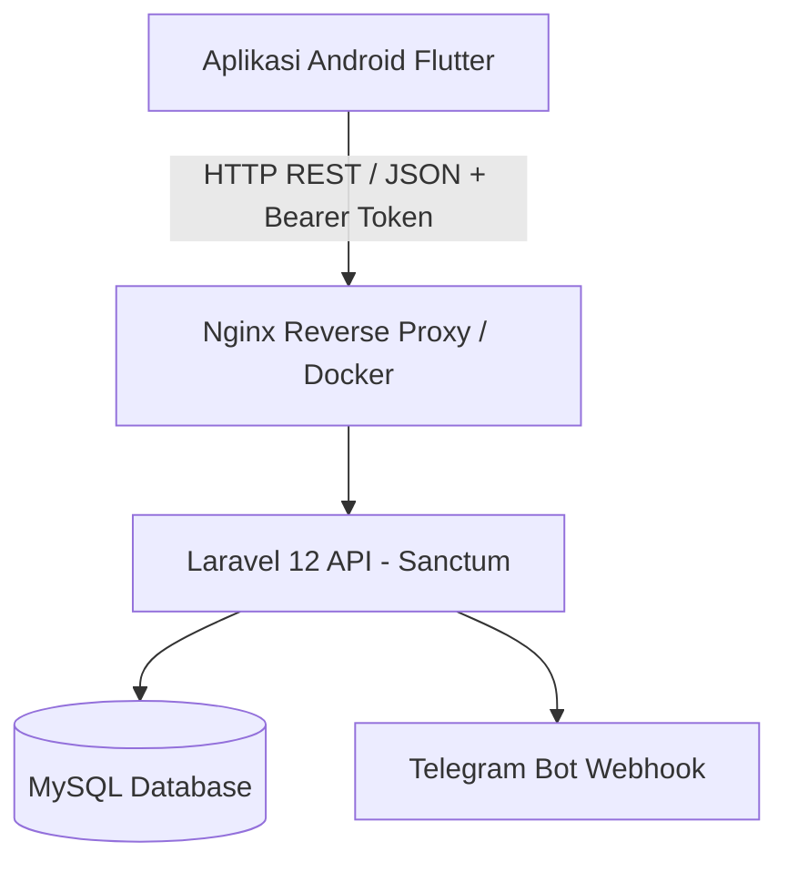

# Rencana Implementasi & Analisis: DompetKuu Backend untuk Android Flutter

## Ringkasan Analisis (Apakah Bisa?)
**JAWABANNYA: SANGAT BISA DAN SUDAH SANGAT SIAP.**

Proyek **DompetKuu** (Laravel 12) ternyata **sudah memiliki fondasi REST API berbasis Laravel Sanctum** lengkap dengan otentikasi token bearer dan controller API di [`src/app/Http/Controllers/Api`](file:///Ubuntu/root/perkuliahan/dompetkuu/src/app/Http/Controllers/Api). 

---

## 1. Pemetaan Endpoint API yang Sudah Tersedia

Berikut endpoint yang sudah aktif di [`src/routes/api.php`](file:///Ubuntu/root/perkuliahan/dompetkuu/src/routes/api.php):

| Modul | Endpoint | HTTP Method | Keterangan |
|---|---|---|---|
| **Autentikasi** | `/api/auth/register` | `POST` | Pendaftaran akun baru |
| | `/api/auth/login` | `POST` | Login user, mengembalikan Bearer Token Sanctum |
| | `/api/auth/me` | `GET` | Profil user login (Role, Parent/Child status) |
| | `/api/auth/logout` | `POST` | Revoke token Sanctum |
| **Dashboard** | `/api/dashboard/stats` | `GET` | Saldo total, pemasukan, pengeluaran |
| | `/api/dashboard/chart` | `GET` | Data visualisasi grafik transaksi |
| **Kategori** | `/api/categories` | `GET` | List kategori pemasukan/pengeluaran |
| **Transaksi** | `/api/transactions` | `GET`, `POST` | Riwayat & tambah pemasukan/pengeluaran |
| | `/api/transactions/{id}` | `GET`, `PUT`, `DELETE` | Detail, edit, dan hapus transaksi |
| **Tabungan (Savings)** | `/api/savings` | `GET`, `POST` | List & buat target tabungan |
| | `/api/savings/{id}` | `GET`, `PUT`, `DELETE` | CRUD detail tabungan |
| | `/api/savings/{id}/deposits` | `GET`, `POST` | Riwayat deposit & setor tabungan |
| **Hutang / Piutang (Debts)** | `/api/debts` | `GET`, `POST` | Daftar & input hutang/piutang |
| | `/api/debts/{id}` | `GET`, `PUT`, `DELETE` | Update hutang/piutang |
| | `/api/debts/{id}/pay` | `POST` | Cicil / lunasi hutang |

---

## 2. Fitur Spesifik DompetKuu yang Perlu Dilengkapi untuk Flutter

Meskipun endpoint utama sudah ada, ada beberapa fitur khas DompetKuu berbasis web Filament yang belum sepenuhnya memiliki API untuk aplikasi mobile:

1. **Family / Approval Workflow API**:
   - Jika aplikasi Flutter digunakan oleh akun **Child**, transaksi statusnya menjadi `pending`.
   - Perlu endpoint untuk akun **Parent** di mobile:
     - `GET /api/parent/approval-queue` (melihat daftar pengeluaran anak yang menunggu persetujuan).
     - `POST /api/parent/approve/{id}` & `POST /api/parent/reject/{id}` (menyetujui/menolak).
2. **Anggaran (Budget) API**:
   - Resource Budget di web Filament sudah ada, tetapi controller REST API untuk `Budget` belum dibuat di `/api/budgets`.
3. **Notifikasi Mobile**:
   - Web menggunakan Filament database notification / Telegram webhook.
   - Untuk Flutter Android, bisa dibuatkan endpoint `GET /api/notifications` serta integrasi Firebase Cloud Messaging (FCM) jika ingin push notification langsung ke HP.

---

## 3. Arsitektur Koneksi Android Flutter ke DompetKuu



### Hal Penting Terkait Jaringan (Networking Android):
- Jika dijalankan di **Android Emulator**, gunakan alamat host `http://10.0.2.2:PORT` (bukan `localhost` atau `127.0.0.1`).
- Jika diuji coba di **Device Fisik Android**, backend harus berada di IP LAN yang sama (misal `http://192.168.1.xxx:8000`) atau dipublish lewat tunneling (seperti Ngrok / Cloudflare Tunnel / VPS Azure).

---

## 4. Tahapan Rencana Pengembangan (Roadmap)

### Fase 1: Standarisasi Response & Penambahan Endpoint
1. Lengkapi endpoint yang belum ada:
   - Endpoint **Budget** (`/api/budgets`)
   - Endpoint **Parent-Child Family & Approval** (`/api/family/*` atau `/api/approvals/*`)
   - Endpoint **Notifications** (`/api/notifications`)
2. Format response standar:
   ```json
   {
     "success": true,
     "message": "Transaksi berhasil disimpan",
     "data": { ... }
   }
   ```

### Fase 2: Pembuatan Proyek Flutter
1. Setup state management (Bloc / Riverpod / Provider).
2. Package pendukung utama:
   - `dio` atau `http` (HTTP Client dengan Interceptor Bearer Token).
   - `flutter_secure_storage` (Menyimpan Sanctum Token secara aman).
   - `fl_chart` (Menampilkan grafik pemasukan & pengeluaran).
3. Pembuatan UI Screen:
   - Login & Register Screen
   - Dashboard (Ringkasan Saldo & Grafik)
   - Transaksi (Tambah Pemasukan / Pengeluaran, Filter Kategori)
   - Tabungan (Savings Target & Deposit)
   - Approval Screen (khusus role Parent)

---

## Pertanyaan / Konfirmasi
1. Apakah aplikasi Flutter nanti ditargetkan untuk **semua role** (Admin, Parent, Child, Personal) atau fokus ke **Parent & Child/Personal**? (Biasanya Admin tetap nyaman di web Filament).
2. Apakah ingin kita buatkan endpoint yang kurang (seperti Approval & Budget API) di backend Laravel ini sekarang?
